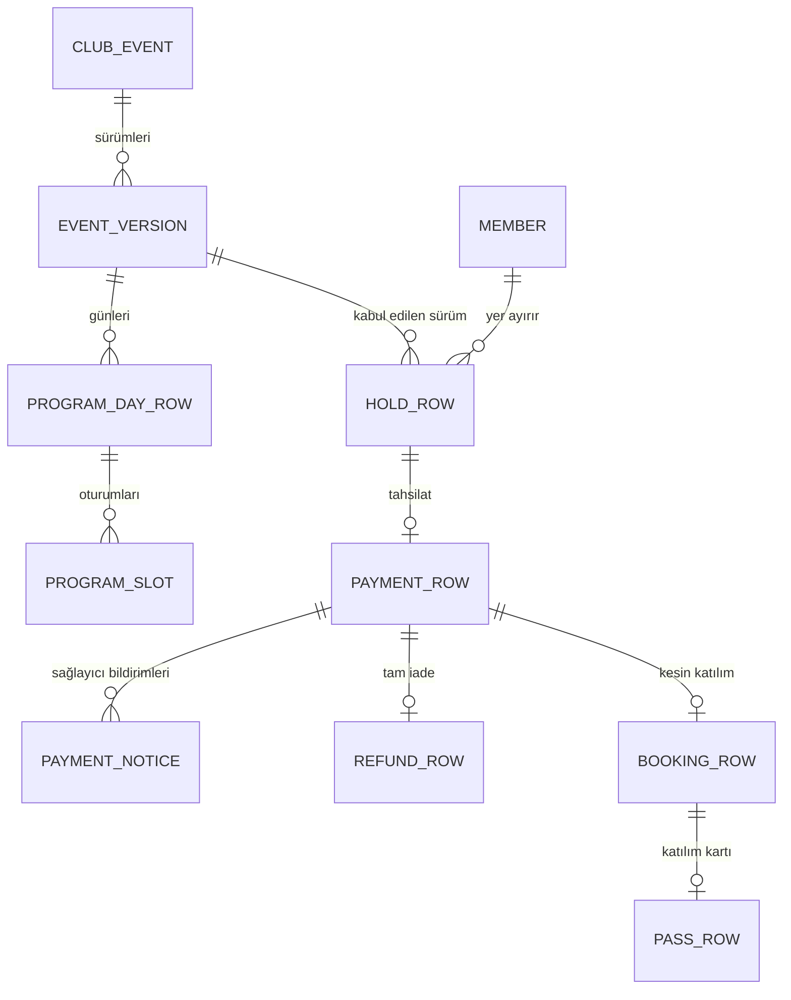

# Vubes Club · Ekran, API ve PostgreSQL ilişkileri

26 Kasım 2026 kontrolü. Bu belge çalışma kopyasındaki backend kodunu ve migration’ları tarif eder. Tam HTTP sözleşmesi `Contracts/mobile.openapi.json`, C# istek ve yanıtları `Contracts/Identity/` ve `Contracts/` altındadır; fiziksel tablo ve kısıtlar `Database/Schema.sql` içindedir.

## Mimari

Tek ASP.NET Core 10 API ve tek PostgreSQL veritabanı kullanılır. EF Core ve Npgsql ile altı modül aynı uygulamada çalışır. Identity üyeliği ve oturumu, Catalog yayımlanan programı, Booking kontenjanı ve katılımı, Payments tahsilat ile iadeyi, Community PT ve puan ilişkilerini, Field etkinlik içi paylaşımı yönetir. Alan servisleri `Modules/`, HTTP oturum kontrolü ve veritabanı bağlantısı `Infrastructure/` altındadır.

## Mobil ekranların veri kaynakları

Ortak URL öneki `/api/v1`. SwiftUI’daki Checkout’un demo ve canlı görünümleri aynı iş akışıdır.

| Ekran | HTTP ve modeller | Temel PostgreSQL ilişkisi |
|---|---|---|
| Welcome | `GET /app/appearance` karşılama görselini verir. Saklı oturum varsa `GET /auth/session` çağrılır. | `mobile_session.member_id → member.id` |
| Sign Up | `POST /auth/application-otp-challenges` → telefon OTP challenge. Davet kodu isteğe bağlıdır. | `otp_challenge` geçici başvuru alanları; geçerli davet varsa `invite_id → invitation.id` |
| Sign In | `POST /auth/otp-challenges` → mevcut üye için telefon OTP challenge. | `member.phone` bulunur; yalnız `member.status = active` olunca oturum açılır. |
| SMS Verification | `POST /auth/otp-challenges/{id}/verify`, `POST …/{id}/resend`, gerektiğinde `POST /auth/session/refresh` | Başvuru doğrulaması → pending `member` ve `application_entry`; aktif üyede oturum. Geçici test OTP'si `Identity:AllowFixedOtp=true` ile açılır ve `1111` kullanır. |
| Membership Review | `GET /auth/session` → üyelik durumu ve sonraki ekran | `member.status` ve `application_entry.member_id` |
| Events | `GET /events` → `EventPage`; `GET /event-filters` → `Filters`; `PUT/DELETE /me/saved-events/{eventId}` | Etkinlik → yayımlanmış sürüm → ana spor. `saved_event` üye ile etkinliği eşler. |
| Explore | `GET /events?hasLocation=true`, isteğe bağlı `bbox` → `EventPage` | Katalog sürümündeki enlem/boylam. Kart ve pin aynı etkinlik kimliğini taşır. |
| Event Details | `GET /events/{eventId}` → `EventDetail`. Katılımlarım’dan gelince `?bookingId=…` kabul edilen sürümü seçer. | `event_version → program_day_row → program_slot` (üstten alta). Ek sporlar, PT, kişisel kayıt ve değerlendirme aynı detayı besler. |
| Checkout | `POST /booking-holds`, `CreateHold → Hold`; `POST /booking-holds/{id}/payments`, `StartPayment → Payment`; `GET /booking-holds/{id}` → `Hold` | `hold_row` üye, etkinlik ve sürüme bağlıdır. `payment_row.hold_id` benzersizdir. Fiyat ve koşul kabul zamanı hold üzerinde sabitlenir. |
| Confirmation | `GET /me/bookings/{bookingId}/pass` → `Pass` | Doğrulanan tahsilat → kesin katılım → katılım kartı |
| My Events | `GET /me/bookings?bucket=upcoming\|inProgress\|past` → `BookingPage` (istek başına bir değer). Detay ve kart uçları ortaktır. | `booking_row.member_id` kayıt sahibini, `version_id` satın alınan programı gösterir. |
| Activity Map | `GET /events/{id}/activity-map` → `ActivityMap`; `PUT …/me/location-sharing`, `PUT …/me/location` | Etkinlik → rota noktaları. Üye + etkinlik → paylaşım → son ölçüm. Yetki katılım veya görevlendirmeden gelir. |
| Club | `GET /club/trainers`, `GET /club/trainers/{id}`, `PUT/DELETE /me/followed-trainers/{id}`, `PUT /me/trainer-introductions/{id}`, `PUT /events/{id}/me/rating` | PT → ekip → üyeler. Sosyal takip, resmî PT ilişkisi, tanışma ve kişisel oy ayrı kayıtlardır. |
| Profile | `GET /me` → `MyProfile`; `GET /me/privacy` → `Privacy`; `DELETE /auth/session` | Üye → abonelik ve varsa PT profili. Görünürlük `member.visibility` alanındadır. |

## Etkinlik ve ödeme ilişkileri

- `club_event.current_version_id` güncel yayını gösterir. Bileşik FK aynı etkinliğin sürümünü zorunlu kılar. Hold ve booking üzerindeki bileşik FK’ler de sürümün etkinlikle eşleşmesini sağlar.
- Kontenjan `club_event.capacity` alanındadır. Yer ayırma ve tahsilat kesinleştirmede aynı etkinlik kilidi kullanılır. Kullanılabilir yer hesabına aktif blokeler ve kesin katılımlar girer.
- `booking_row` üzerinde kesin kayıtlar için üye + etkinlik benzersizdir. `payment_notice` üzerinde sağlayıcı + dış olay kimliği benzersizdir. Tek ödeme başına bir iade kaydı tutulur.
- Sağlayıcının doğruladığı ödeme zamanı ve 10 dakikalık son süre karşılaştırılır. Belirsizlikte en fazla 5 dakika ek koltuk blokesi tanınır. Geç ödeme tam iadeye gider. Zamanında ödenip geç bildirilen işlemde kapasite yeniden kontrol edilir.
- Ödeme sonucu sağlayıcı bildirimi ve üyenin durum sorgusu üzerinden işlenir. Arka plan işi yoktur. Her iki kanalın da gelmediği bir olay için otomatik zamanlanmış mutabakat bu sürümde bulunmaz.

## Fiziksel sözlük

Aşağıdaki liste doğrudan ilk migration’ın DDL tanımlarından çıkarılmıştır. `PK` her tablonun birincil anahtarıdır. Son sütundaki oklar **çocuk kolon → başvurulan PK veya benzersiz kolon grubu** yönündedir. Kısmi benzersizlik kurallarının tam ifadeleri SQL dosyasındadır.

| Tablo | Kolonlar (PK: `id`) | Yabancı anahtarlar |
|---|---|---|
| `member` | `id`, `phone`, `email`, `full_name`, `status`, `avatar`, `cover`, `visibility` | — |
| `trainer` | `id`, `member_id`, `specialty`, `bio`, `experience`, `location`, `cover` | `member_id → member(id)` |
| `invitation` | `id`, `digest`, `trainer_id`, `expires`, `used_by` | `trainer_id → trainer(id)` `used_by → member(id)` |
| `application_entry` | `id`, `member_id`, nullable `invitation_id`, `adult_declared_at`, `university`, `job_title`, `workplace`, `instagram`, `linkedin`, `submitted_at` | `member_id → member(id)` `invitation_id → invitation(id)` |
| `otp_challenge` | `id`, `phone`, `invite_id`, `full_name`, application profile fields, `digest`, `expires`, `resend_at`, `created`, `attempts`, `consumed` | `invite_id → invitation(id)` |
| `mobile_session` | `id`, `member_id`, `access_digest`, `refresh_digest`, `access_expires`, `expires`, `revoked` | `member_id → member(id)` |
| `subscription` | `id`, `member_id`, `starts`, `ends` | `member_id → member(id)` |
| `sport_row` | `id`, `code`, `label`, `fallback_cover` | — |
| `club_event` | `id`, `trainer_id`, `current_version_id`, `published`, `cancelled`, `capacity`, `minimum_confirmed`, `opens`, `closes`, `premium_opens` | `trainer_id → trainer(id)` `current_version_id → event_version(id)` `id, current_version_id → event_version(event_id, id)` |
| `event_version` | `id`, `event_id`, `revision`, `title`, `place`, `starts`, `ends`, `time_zone`, `sport_id`, `level`, `cover`, `distance_meters`, `amount`, `currency`, `latitude`, `longitude`, `meeting`, `directions`, `preparation`, `lodging`, `transport`, `terms_version`, `terms_url` | `event_id → club_event(id)` `sport_id → sport_row(id)` |
| `additional_sport` | `id`, `version_id`, `sport_id` | `version_id → event_version(id)` `sport_id → sport_row(id)` |
| `program_day_row` | `id`, `version_id`, `day`, `ordinal` | `version_id → event_version(id)` |
| `program_slot` | `id`, `day_id`, `ordinal`, `starts`, `ends`, `title`, `details` | `day_id → program_day_row(id)` |
| `saved_event` | `id`, `member_id`, `event_id` | `member_id → member(id)` `event_id → club_event(id)` |
| `follow` | `id`, `member_id`, `trainer_id` | `member_id → member(id)` `trainer_id → trainer(id)` |
| `introduction_row` | `id`, `member_id`, `trainer_id`, `state`, `requested_at` | `member_id → member(id)` `trainer_id → trainer(id)` |
| `trainer_link` | `id`, `member_id`, `trainer_id` | `member_id → member(id)` `trainer_id → trainer(id)` |
| `crew_row` | `id`, `trainer_id`, `name` | `trainer_id → trainer(id)` |
| `crew_mate` | `id`, `crew_id`, `member_id` | `crew_id → crew_row(id)` `member_id → member(id)` |
| `hold_row` | `id`, `member_id`, `event_id`, `version_id`, `state`, `expires`, `verify_until`, `amount`, `currency`, `terms_version`, `accepted_at` | `member_id → member(id)` `event_id → club_event(id)` `version_id → event_version(id)` `event_id, version_id → event_version(event_id, id)` |
| `payment_row` | `id`, `hold_id`, `provider`, `reference`, `amount`, `currency`, `status`, `redirect`, `paid_at` | `hold_id → hold_row(id)` |
| `payment_notice` | `id`, `provider`, `external_id`, `payment_id`, `received` | `payment_id → payment_row(id)` |
| `refund_row` | `id`, `payment_id`, `reason`, `status` | `payment_id → payment_row(id)` |
| `request_key` | `id`, `member_id`, `operation`, `key`, `fingerprint`, `resource_id` | `member_id → member(id)` |
| `booking_row` | `id`, `member_id`, `event_id`, `version_id`, `payment_id`, `status`, `attendance` | `member_id → member(id)` `event_id → club_event(id)` `version_id → event_version(id)` `payment_id → payment_row(id)` `event_id, version_id → event_version(event_id, id)` |
| `pass_row` | `id`, `booking_id`, `nonce`, `revoked` | `booking_id → booking_row(id)` |
| `assignment` | `id`, `member_id`, `event_id`, `starts`, `ends` | `member_id → member(id)` `event_id → club_event(id)` |
| `rating_row` | `id`, `member_id`, `event_id`, `stars`, `moderation` | `member_id → member(id)` `event_id → club_event(id)` |
| `route_point` | `id`, `event_id`, `ordinal`, `latitude`, `longitude` | `event_id → club_event(id)` |
| `location_share` | `id`, `event_id`, `member_id`, `alias`, `expires`, `revoked` | `event_id → club_event(id)` `member_id → member(id)` |
| `last_location` | `id`, `share_id`, `sequence`, `recorded`, `latitude`, `longitude` | `share_id → location_share(id)` |

## Doğrulama ve kalan işler

23 Kasım kontrolünde Release derlemesi geçti. Test hostundaki 27 metot ve yol sözleşmeyle eşleşti. Anonim isteklerde 23 korumalı işlem 401 döndü. Npgsql katalog, PT ve uygunluk sorgularını SQL’e çevirdi. EF ilk migration SQL’ini üretti. Geliştirme verisi ayrı ve isteğe bağlıdır.

| Durum | Teslim veya kabul ölçütü |
|---|---|
| PostgreSQL uçtan uca testi açık | Temiz bir test veritabanında migration ve seed uygulansın. Davet → OTP → üyelik kararı, katalog → yer ayırma → ödeme sonucu → kart zinciri doğrulansın. İki üyenin son koltuğu eşzamanlı istemesi, tekrarlanan bildirim ve geç ödeme/iade sınansın. |
| SMS sağlayıcısı beklemede | Test için `Identity:AllowFixedOtp=true` ayarı tüm telefon numaralarında `1111` kodunu kabul eder; gerçek kullanıcılara açık sunucuda bu ayar güvenli değildir. Üretim SMS sağlayıcısı bağlandığında kapatılmalıdır. |
| Tahsilat sağlayıcısı anlaşmaya bağlı | Etkinlik bazlı ödeme arayüzü ve sunucu akışı vardır. Sağlayıcı seçildiğinde sipariş açma, imzalı bildirimi doğrulama, durum sorgulama ve tam iade gerçek adaptörde sınanmalıdır. |
| Karar ve saha geçmişi sınırlı | Güncel üyelik kararı member.status, güncel katılım durumu booking_row.attendance alanındadır. Başvuru kararını kimin ne zaman verdiği ve saha durum değişikliklerinin geçmişi ayrı kayıt olarak modellenmemiştir. |
| İzin ayrıntısı açık | Saha görevlendirmesinde etkinlik ve geçerlilik tarihleri vardır. Haritayı görüntüleme ile konum yayınlama için ayrı görev izinleri yoktur. Değerlendirmede fiilî katılım ve moderasyon bulunur, ayrıca bir değerlendirme izni kaydı yoktur. |
